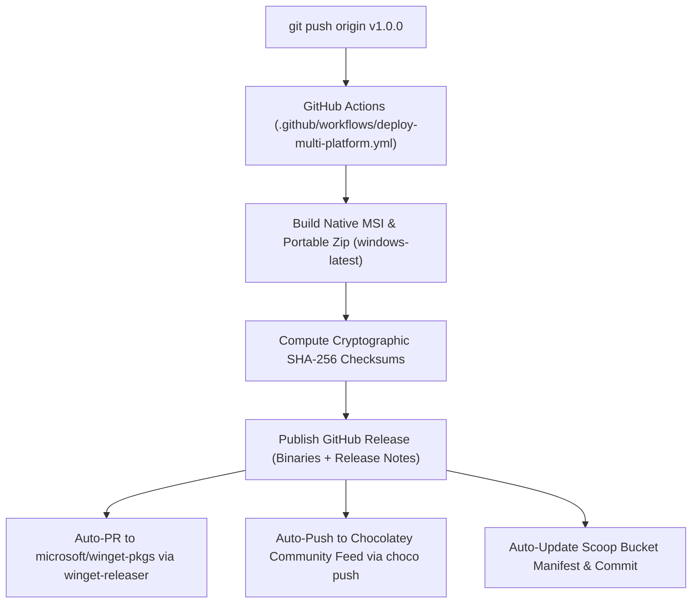

# CleanPilot — Global Marketing & Multi-Site Deployment Guide 🚀

> **A Strategic Playbook for Launching, Distributing, and Scaling CleanPilot Across Global Software Directories, Package Managers, and Tech Communities.**

---

## 📑 Table of Contents

1. [Executive Summary & Brand Positioning](#1-executive-summary--brand-positioning)
2. [Brand Asset Kit & Visual Identity](#2-brand-asset-kit--visual-identity)
3. [Package Manager & Software Repository Deployments](#3-package-manager--software-repository-deployments)
   - [3.1 Windows Package Manager (Winget)](#31-windows-package-manager-winget)
   - [3.2 Chocolatey Community Repository](#32-chocolatey-community-repository)
   - [3.3 Scoop Community Bucket](#33-scoop-community-bucket)
   - [3.4 GitHub Releases & CI/CD Packaging](#34-github-releases--cicd-packaging)
   - [3.5 Microsoft Store (Win32 / MSIX)](#35-microsoft-store-win32--msix)
   - [3.6 Free Software Hubs (FossHub, Softpedia, MajorGeeks)](#36-free-software-hubs-fosshub-softpedia-majorgeeks)
4. [Software Comparison & Discovery Platforms](#4-software-comparison--discovery-platforms)
   - [4.1 AlternativeTo.net Strategy](#41-alternativetonet-strategy)
   - [4.2 SaaSHub, Product Hunt & DevHunt](#42-saashub-product-hunt--devhunt)
5. [Community Launch Playbook](#5-community-launch-playbook)
   - [5.1 Hacker News (Show HN)](#51-hacker-news-show-hn)
   - [5.2 Reddit Community Outreach](#52-reddit-community-outreach)
   - [5.3 Twitter/X, Mastodon & LinkedIn](#53-twitterx-mastodon--linkedin)
6. [Website Landing Page & SEO Playbook](#6-website-landing-page--seo-playbook)
7. [Tech Press & Influencer Outreach Kit](#7-tech-press--influencer-outreach-kit)
8. [Launch Execution Timeline (T-14 Days to T+30 Days)](#8-launch-execution-timeline-t-14-days-to-t30-days)
9. [Full CI/CD Automated Multi-Platform Deployment](#9-full-cicd-automated-multi-platform-deployment)

---

## 1. Executive Summary & Brand Positioning

### 1.1 The Market Opportunity: "The Anti-CCleaner"
For years, the desktop PC cleanup space has been infested with deceptive scareware, simulated progress animations, predatory monetization, aggressive upsells, and background tracking telemetry. 

**CleanPilot flips this paradigm on its head:**
- **100% Offline & Zero Telemetry**: Absolutely no data ever leaves the user's workstation. No analytics, no phone-home pings, no cloud indexing.
- **Authentic System Telemetry**: Driven entirely by native OS APIs and hardware sensors via **OSHI** and Java NIO.2.
- **Engineered for Power Users & Developers**: Preset filters for massive developer caches (`node_modules`, `.gradle/caches`, `target`, `.venv`), memory-bounded off-heap streaming deduplication (SHA-256 via 128 KB Direct ByteBuffers), and built-in threat hunting for stealth crypto-miners and reverse-shell LOLBins.

### 1.2 Target Audience Matrix

| Target Segment | Core Pain Point | CleanPilot Value Hook |
| :--- | :--- | :--- |
| **Software Developers** | `node_modules`, Docker cache, Gradle cache consuming 50GB+ across dozens of stale projects | **Developer Cache Cleaner**: 1-click detection of developer artifacts across multi-drive trees with zero UI freeze. |
| **Privacy Enthusiasts / Sysadmins** | Commercial cleaners phoning home, collecting telemetry, and bundling adware | **Zero Telemetry Manifesto**: 100% offline, fully transparent, verifiable local SQLite database. |
| **Laptop & Mobile Workers** | Mystery battery drain, high thermals, throttling, mysterious kernel memory leaks | **Laptop Diagnostics Hub**: Real battery degradation wear-rate, thermal throttling detection, and Non-Paged driver leak alerts. |
| **Gamers & PC Enthusiasts** | Unexplained background CPU spikes, hidden mining malware, duplicate multi-gigabyte game files | **Threat Hunter & Stream Dedupe**: Shannon high-entropy scanner, LolBins network socket correlation, and byte-boundary fast deduplication. |

---

## 2. Brand Asset Kit & Visual Identity

All official brand assets have been generated and structured under `docs/assets/logo/` and `src/main/resources/icons/`:

### 2.1 File Directory Structure
```
Clean/
├── docs/assets/logo/
│   ├── cleanpilot-icon.svg             # Scalable vector square app icon
│   ├── cleanpilot-logo-dark.svg        # Horizontal brand logo with typography (Dark mode)
│   ├── cleanpilot-logo-light.svg       # Horizontal brand logo with typography (Light mode)
│   ├── cleanpilot-banner.svg           # 1280x640 OpenGraph & GitHub hero banner
│   ├── cleanpilot-app-icon-1024.png    # 1024x1024 Ultra-HD Master Icon
│   ├── cleanpilot-512x512.png          # High-DPI Store & Marketplace icon
│   ├── cleanpilot-256x256.png          # Standard installer / repository icon
│   ├── cleanpilot-128x128.png          # Medium display icon
│   ├── cleanpilot-64x64.png            # Standard thumbnail
│   ├── cleanpilot-48x48.png            # Desktop shortcut size
│   ├── cleanpilot-32x32.png            # File explorer list size
│   ├── cleanpilot-16x16.png            # Small taskbar icon
│   ├── cleanpilot.ico                  # Multi-resolution Windows ICO (16, 32, 48, 64, 128, 256)
│   └── favicon.ico                     # Web browser favicon
└── src/main/resources/icons/           # Bundled directly into the JavaFX runtime & jpackage
```

### 2.2 Brand Colors & Typography
- **Cobalt Primary Accent**: `#2563EB` (RGB: 37, 99, 235)
- **Vibrant Indigo**: `#6366F1` (RGB: 99, 102, 241)
- **Electric Cyan Glow**: `#38BDF8` (RGB: 56, 189, 248)
- **Background Slate**: `#0F172A` (RGB: 15, 23, 42)
- **Surface Dark Slate**: `#1E293B` (RGB: 30, 41, 59)
- **Typography**: `Segoe UI Variable Text`, `-apple-system`, `Inter`, `sans-serif`

---

## 3. Package Manager & Software Repository Deployments

Distributing via native command-line package managers provides instant credibility with engineers, sysadmins, and tech-savvy users.

### 3.1 Windows Package Manager (Winget)

Winget is Microsoft's official package manager pre-installed on Windows 10 and 11. Over 20 million power users install software exclusively through `winget install`.

#### Submission Process:
1. Manifests are already configured in `distribution/winget/`:
   - `CleanPilot.CleanPilot.yaml` (Version root)
   - `CleanPilot.CleanPilot.installer.yaml` (Architecture, URL, SHA256)
   - `CleanPilot.CleanPilot.locale.en-US.yaml` (Metadata, description, tags)
2. Build the MSI release package:
   ```powershell
   ./gradlew packageMsi
   ```
3. Calculate the SHA-256 hash of the generated installer:
   ```powershell
   Get-FileHash -Algorithm SHA256 build/dist/CleanPilot-1.0.0.msi
   ```
4. Insert the calculated hash into `distribution/winget/CleanPilot.CleanPilot.installer.yaml`.
5. Fork [microsoft/winget-pkgs](https://github.com/microsoft/winget-pkgs).
6. Use the official `wingetcreate` CLI tool or submit a Pull Request:
   ```powershell
   wingetcreate submit https://github.com/cleanpilot/cleanpilot/releases/download/v1.0.0/CleanPilot-1.0.0.msi
   ```
7. Once merged by Microsoft automation bots, any user on Windows can install CleanPilot with a single command:
   ```powershell
   winget install cleanpilot
   ```

---

### 3.2 Chocolatey Community Repository

Chocolatey is the dominant enterprise and power-user package manager for Windows with hundreds of millions of downloads.

#### Submission Process:
1. Files are pre-configured in `distribution/chocolatey/`:
   - `cleanpilot.nuspec`
   - `tools/chocolateyinstall.ps1`
2. Update the `checksum64` in `tools/chocolateyinstall.ps1` with the SHA-256 hash of your GitHub Release MSI.
3. Pack the NuGet package:
   ```powershell
   choco pack distribution/chocolatey/cleanpilot.nuspec
   ```
4. Test installation locally in sandbox:
   ```powershell
   choco install cleanpilot --source . -y
   ```
5. Obtain your Chocolatey API Key from [chocolatey.org/account](https://community.chocolatey.org/account).
6. Push the package to the official Chocolatey repository:
   ```powershell
   choco apikey --key <YOUR_API_KEY> --source https://push.chocolatey.com/
   choco push cleanpilot.1.0.0.nupkg --source https://push.chocolatey.com/
   ```
7. After automated verification (AVT) passes, users can install via:
   ```powershell
   choco install cleanpilot -y
   ```

---

### 3.3 Scoop Community Bucket

Scoop is beloved by developers because it installs portable apps cleanly in the user's directory without UAC prompts or registry pollution.

#### Submission Process:
1. Scoop manifest is located at `distribution/scoop/cleanpilot.json`.
2. Generate the portable zip containing `CleanPilot`:
   ```powershell
   ./gradlew packageAppImage
   Compress-Archive -Path build/dist/CleanPilot -DestinationPath build/dist/CleanPilot-1.0.0-portable.zip
   ```
3. Compute the SHA-256 hash:
   ```powershell
   Get-FileHash -Algorithm SHA256 build/dist/CleanPilot-1.0.0-portable.zip
   ```
4. **Option A (Dedicated Scoop Bucket - Instant)**:
   Create a GitHub repo named `scoop-cleanpilot` and place `cleanpilot.json` in `bucket/cleanpilot.json`.
   Users install with:
   ```powershell
   scoop bucket add cleanpilot https://github.com/cleanpilot/scoop-cleanpilot
   scoop install cleanpilot
   ```
5. **Option B (Submit to Scoop Extras Bucket)**:
   Submit a PR adding `cleanpilot.json` to [ScoopInstaller/Extras](https://github.com/ScoopInstaller/Extras). Once merged, anyone can install with `scoop install extras/cleanpilot`.

---

### 3.4 GitHub Releases & CI/CD Packaging

GitHub is the single source of truth for open-source and privacy-focused software.

#### Automated GitHub Actions Workflow (`.github/workflows/release.yml`):
Create this workflow to build, sign, and publish MSI & portable binaries automatically on every `git tag`:

```yaml
name: Release Build
on:
  push:
    tags:
      - 'v*'

jobs:
  build:
    runs-on: windows-latest
    steps:
      - uses: actions/checkout@v4
      - name: Set up JDK 21
        uses: actions/setup-java@v4
        with:
          java-version: '21'
          distribution: 'temurin'
      - name: Setup Gradle
        uses: gradle/actions/setup-gradle@v3
      - name: Build MSI & AppImage
        run: |
          ./gradlew packageAppImage packageMsi
          Compress-Archive -Path build/dist/CleanPilot -DestinationPath build/dist/CleanPilot-${{ github.ref_name }}-portable.zip
      - name: Generate Checksums
        run: |
          Get-FileHash build/dist/*.msi, build/dist/*.zip -Algorithm SHA256 | Out-File -FilePath build/dist/SHA256SUMS.txt
      - name: Publish GitHub Release
        uses: softprops/action-gh-release@v2
        with:
          files: |
            build/dist/*.msi
            build/dist/*.zip
            build/dist/SHA256SUMS.txt
          generate_release_notes: true
```

---

### 3.5 Microsoft Store (Win32 / MSIX)

The Microsoft Store gives direct access to over 1 billion Windows users with zero security warnings (SmartScreen reputation is granted automatically).

#### Process:
1. Register for a **Windows Developer Account** at [partner.microsoft.com/dashboard](https://partner.microsoft.com/dashboard) ($19 one-time personal fee).
2. Microsoft allows traditional Win32 desktop apps packaged as `.msi` or `.exe` via URL submission.
3. Reserve the app name: **CleanPilot**.
4. Upload `docs/assets/logo/cleanpilot-app-icon-1024.png` for store graphics and provide 4-6 high-resolution screenshots of the dashboard, threat hunter, and duplicate scanner.
5. In the privacy statement field, link to your zero-telemetry policy:
   > *"CleanPilot is a 100% offline desktop application. It does not collect, transmit, store, or share any telemetry, personal data, or usage metrics."*
6. Review turnaround is typically 24 to 48 hours.

---

### 3.6 Free Software Hubs (FossHub, Softpedia, MajorGeeks)

These legacy hubs drive significant organic desktop traffic and rank high in Google searches for Windows utilities.

| Platform | URL | Submission Type | Key Benefit |
| :--- | :--- | :--- | :--- |
| **FossHub** | [fosshub.com](https://www.fosshub.com) | Email application (`contact@fosshub.com`) | Dedicated exclusively to FOSS & non-bloatware tools. Zero adware policy matches CleanPilot perfectly. |
| **Softpedia** | [softpedia.com/developer](https://www.softpedia.com) | Developer Portal / PAD File | Issues "100% Clean / No Malware" certification badge; huge SEO boost and backlinks. |
| **MajorGeeks** | [majorgeeks.com](https://www.majorgeeks.com) | Submission form | Beloved by veteran Windows sysadmins and power users; reviews apps individually. |
| **SnapFiles** | [snapfiles.com](https://www.snapfiles.com) | Software submission form | Hand-curates high quality freeware with independent ratings. |

---

## 4. Software Comparison & Discovery Platforms

### 4.1 AlternativeTo.net Strategy

AlternativeTo.net is the #1 discovery engine for users searching for alternatives to bloated software. When users search *"Alternatives to CCleaner"*, AlternativeTo ranks #1 on Google.

#### Execution Plan:
1. Create a page for **CleanPilot** on [alternativeto.net](https://alternativeto.net).
2. Set tags:
   - Primary: `Disk Cleaner`, `System Optimizer`, `Duplicate File Finder`, `Hardware Monitoring`.
   - Secondary: `Open Source`, `Zero Telemetry`, `Portable`, `Privacy Focused`.
3. Add CleanPilot as an alternative to:
   - **CCleaner** (Highlight: Zero ads, zero background telemetry, authentic metrics)
   - **BleachBit** (Highlight: Modern Windows 11 Fluent UI, Java 21 performance, threat hunting)
   - **WizTree & TreeSize Free** (Highlight: Streaming hash duplicate detection, developer cache cleanup)
   - **SpaceSniffer** (Highlight: Active process blocking identification, laptop diagnostics)
   - **GlassWire** (Highlight: LOLBin network socket correlation without commercial upsell)
4. Add high-res screenshots and link to GitHub.

---

### 4.2 SaaSHub, Product Hunt & DevHunt

- **DevHunt** ([devhunt.org](https://devhunt.org)): Launchpad for developer tools. Perfect fit for CleanPilot's `node_modules` and `.gradle` cache cleaner.
- **Product Hunt** ([producthunt.com](https://www.producthunt.com)): Launch as an honest, privacy-first desktop utility.
- **SaaSHub** ([saashub.com](https://www.saashub.com)): Submit software profile for automatic software alternative indexing.

---

## 5. Community Launch Playbook

### 5.1 Hacker News (Show HN)

Hacker News values deep technical craftsmanship, openness, privacy, and honesty. Emphasize the architectural feats and the zero-telemetry philosophy.

#### Post Title:
```
Show HN: CleanPilot – Privacy-first Windows disk analyzer and threat hunter (Zero telemetry)
```

#### First Comment (The Maker Narrative):
> *Hey HN!*  
>  
> *I built CleanPilot because I got fed up with the state of desktop maintenance tools on Windows. Almost every popular cleaner has degraded into adware, telemetry-heavy nagware, or fake cleaners with simulated progress bars.*  
>  
> *CleanPilot is built on three strict principles: 100% offline (zero network telemetry), authentic hardware metrics via OSHI, and zero UI freezes.*  
>  
> *Some technical highlights:*  
> *- **Java 21 Virtual Threads**: Every disk traversal, boundary check, and threat scan executes on lightweight virtual threads with zero thread-pool exhaustion.*  
> *- **Memory-Bounded Streaming Deduplication**: Instead of reading multi-gigabyte files into memory, we use a 3-pass pipeline: physical Inode dedupe -> two-sided 4 KB boundary hash via FileChannel -> parallel off-heap 128 KB Direct ByteBuffer SHA-256 streaming.*  
> *- **Developer Cache Presets**: Recovers 10s of gigabytes from forgotten `node_modules`, `.gradle/caches`, `.venv`, and `target` directories.*  
> *- **Threat & LOLBin Hunter**: Real-time socket correlation with windowless binaries running from `%TEMP%`, Shannon high-entropy scanning for packed malware, and NtSuspendProcess thread freezing.*  
>  
> *It's completely free, packages natively into an MSI via jpackage, and requires no Java installation. Would love your feedback and brutal critiques on the architecture!*  
>  
> *Repo & Downloads: https://github.com/cleanpilot/cleanpilot*

---

### 5.2 Reddit Community Outreach

Target subreddits with tailored messaging suited to each community's specific culture. **Never spam; always provide genuine engineering value.**

| Subreddit | Angle & Post Focus | Title Idea |
| :--- | :--- | :--- |
| **`r/windows`** | Modern UI & Native feel; clean alternative to bloated tools | *"I got tired of bloated PC cleaners with fake progress bars, so I built an honest, zero-telemetry Windows optimizer in Fluent UI"* |
| **`r/sysadmin`** | Safe deletions, LOLBin threat detection, battery & driver non-paged pool leak alerts | *"CleanPilot: Open-source, zero-telemetry disk analyzer and threat hunter for Windows (No cloud pings, offline-first)"* |
| **`r/programming`** | Reclaiming disk space from forgotten developer build caches | *"Reclaiming 80 GB of forgotten node_modules and gradle caches with memory-bounded parallel NIO.2 streaming"* |
| **`r/pcmasterrace`** | Laptop battery wear-rate diagnostics, thermal throttling detection, crypto-miner hunter | *"Free, lightweight tool to check real battery wear rate, thermal throttling, and background crypto-miners on Windows"* |
| **`r/privacy`** | Zero-telemetry policy, local SQLite storage, 100% offline verification | *"CleanPilot: A 100% offline desktop cleaner and disk analyzer that strictly bans telemetry and network access"* |

---

### 5.3 Twitter/X, Mastodon & LinkedIn

#### Launch Tweet / Thread:
> 🚀 Introducing CleanPilot — The honest, privacy-first desktop disk analyzer & system hub for Windows.  
>  
> ❌ No fake progress bars  
> ❌ No cloud tracking or telemetry  
> ❌ No adware or upsells  
>  
> ✅ 100% Offline  
> ✅ 3-pass streaming SHA-256 file dedupe  
> ✅ Developer cache cleaner (`node_modules`, `.gradle`)  
> ✅ Stealth crypto-miner & LOLBin hunter  
>  
> Built with Java 21 Virtual Threads, Spring Boot 3 & AtlantaFX.  
>  
> 📦 Install via Winget: `winget install cleanpilot`  
> 💻 GitHub: github.com/cleanpilot/cleanpilot  
>  
> #Windows #OpenSource #Java #DevTools #Privacy

---

## 6. Website Landing Page & SEO Playbook

### 6.1 Landing Page Architecture
1. **Hero Section**:
   - Headline: *"The Honest, Zero-Telemetry System & Storage Hub for Windows."*
   - Subheadline: *"Reclaim disk space, hunt stealth background threats, and inspect hardware health — 100% offline with zero telemetry."*
   - CTA: `Download for Windows (.msi)` + `Install via Terminal: winget install cleanpilot`
   - Hero Graphic: `docs/assets/logo/cleanpilot-banner.svg` or an interactive desktop screenshot.
2. **"Why CleanPilot?" vs. Traditional Cleaners Comparison Grid**:
   - CleanPilot vs. CCleaner vs. BleachBit vs. WizTree.
3. **Core Feature Walkthrough**:
   - Memory-bounded streaming duplicate detection
   - Developer cache cleaner (node_modules, target, gradle)
   - Laptop health & thermal diagnostics
   - Threat hunter & stealth miner detection
4. **Safety & Privacy Manifesto**:
   - Verifiable offline operation, safe trash restoration via Windows Recycle Bin, zero simulated numbers.
5. **Download & Package Manager Badges**:
   - Winget, Chocolatey, Scoop, GitHub Releases, MSI installer.

### 6.2 High-Intent SEO Keywords
- `privacy-first windows cleaner`
- `zero telemetry disk analyzer`
- `find duplicate files without lag`
- `clean node_modules windows tool`
- `laptop battery wear rate tool windows 11`
- `detect background crypto miner windows`
- `open source ccleaner alternative`

---

## 7. Tech Press & Influencer Outreach Kit

### 7.1 Media Target List
- **BleepingComputer** (`tips@bleepingcomputer.com`) — Focused on security, malware detection, and genuine system utilities.
- **Ghacks.net** (`martin@ghacks.net`) — Leading authority on Windows freeware and privacy tools.
- **MakeUseOf / How-To Geek** — Guides on freeing disk space and Windows maintenance.
- **XDA Developers & Neowin** — Enthusiast Windows coverage.

### 7.2 Pitch Email Template
```
Subject: CleanPilot: An open, zero-telemetry Windows disk analyzer and threat hunter

Hi [Name],

I'm reaching out because you frequently cover privacy-friendly Windows utilities and system software.

Most users are fed up with PC cleaners that have devolved into adware, telemetry-heavy trackers, or tools that show fake "PC health" alerts.

We built CleanPilot (https://github.com/cleanpilot/cleanpilot) to solve this:
- 100% Offline & Zero Telemetry: No network pings, no cloud tracking, no upsells.
- Authentic Metrics: Powered directly by OSHI and Windows kernel APIs.
- Memory-Bounded Deduplication: 3-pass parallel streaming SHA-256 using off-heap Direct ByteBuffers that never blow out memory on large files.
- Developer Cache Cleaner: One-click reclamation for node_modules, .gradle/caches, .venv, and target folders.
- Threat Hunter: Detects LOLBins, outbound reverse shells, and background crypto-miners.

It's completely free and open-source, packaged as a native Windows MSI and available on Winget (`winget install cleanpilot`).

Asset kit & screenshots: https://github.com/cleanpilot/cleanpilot/tree/main/docs/assets/logo

Happy to provide any technical details or a quick demo!

Best regards,
CleanPilot Team
```

---

## 8. Launch Execution Timeline (T-14 Days to T+30 Days)

```
Phase 1: Pre-Launch (T-14 to T-1)
  ├── Day 14: Finalize MSI packaging with embedded brand icons & .ico
  ├── Day 10: Create GitHub Release v1.0.0 & calculate SHA-256 hashes
  ├── Day 7:  Submit Winget manifest to microsoft/winget-pkgs
  ├── Day 5:  Submit Chocolatey & Scoop packages
  ├── Day 3:  Setup AlternativeTo.net, Softpedia, and FossHub listings
  └── Day 1:  Prepare Product Hunt, Hacker News, and Reddit copy

Phase 2: Launch Week (T-0 to T+3)
  ├── Hour 00:01 PST: Launch on Product Hunt (Tuesday)
  ├── Hour 06:00 PST: Post "Show HN: CleanPilot" on Hacker News
  ├── Hour 09:00 PST: Submit tailored posts to r/windows, r/programming, r/sysadmin
  ├── Hour 10:00 PST: Send press pitch to Ghacks and BleepingComputer
  └── Hour 12:00 PST: Post launch announcement thread on Twitter/X, Bluesky, Mastodon

Phase 3: Growth & Momentum (T+4 to T+30)
  ├── Monitor Winget / Chocolatey install telemetry (locally non-invasive stats)
  ├── Address community feedback & bug reports on GitHub Issues
  ├── Submit to Microsoft Store via Partner Center
  └── Release v1.1.0 with community-requested developer cache presets
```

---

## 9. Full CI/CD Automated Multi-Platform Deployment

CleanPilot is fully automated to deploy across GitHub Releases, Windows Package Manager (Winget), Chocolatey, and Scoop whenever a Git tag is pushed.



### 9.1 GitHub Actions Workflow
The workflow is located at `.github/workflows/deploy-multi-platform.yml` and triggers automatically on:
```bash
git tag v1.0.0
git push origin v1.0.0
```
It can also be manually dispatched from the GitHub Actions UI with custom version inputs.

### 9.2 Required GitHub Secrets

To enable 100% hands-off automated deployment, configure these 3 secrets in your GitHub repository (`Settings -> Secrets and variables -> Actions`):

| Secret Name | Source | Purpose |
| :--- | :--- | :--- |
| `WINGET_TOKEN` | GitHub Personal Access Token (`public_repo` scope) | Automatically forks `microsoft/winget-pkgs`, updates YAML manifests with the MSI SHA-256 hash, and creates the submission Pull Request to Microsoft. |
| `CHOCOLATEY_API_KEY` | [community.chocolatey.org](https://community.chocolatey.org/account) | Automatically packages the `.nupkg` and pushes directly to the Chocolatey package feed. |
| `SCOOP_BUCKET_PAT` | GitHub Personal Access Token (`repo` scope) | Commits the updated `cleanpilot.json` manifest with the portable zip URL and hash to your Scoop bucket repository. |
| `SCOOP_BUCKET_REPO` | e.g. `your-username/scoop-cleanpilot` | Target Scoop bucket repository name. |

### 9.3 Local Release CLI Automation Engine
For local testing, dry-runs, and manifest synchronization:
```powershell
# Run the release script locally:
.\scripts\release.ps1 -Version "1.0.0" -SkipTests
```
This script builds the portable zip and updates `distribution/winget/`, `distribution/chocolatey/`, and `distribution/scoop/` manifests with verified SHA-256 hashes.

---

*CleanPilot — Honest, Privacy-First Storage Management. Built with integrity.*
