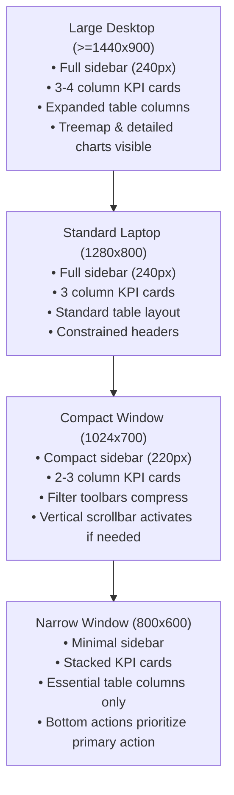

# CleanPilot — Responsive Layout Strategy & DPI Scaling Architecture

**Version**: 1.0.0  
**Target Desktop Window Profiles**:
* **Large Desktop**: 1440 × 900+ logical pixels
* **Standard Laptop**: 1280 × 800 logical pixels
* **Compact Window**: 1024 × 700 logical pixels
* **Narrow / Restored**: 800 × 600 logical pixels

---

## 1. Principles of Desktop JavaFX Responsiveness

Unlike web browsers that rely on CSS media queries, JavaFX desktop applications require declarative layout constraints, property bindings, and scene width/height change listeners.

CleanPilot enforces three foundational layout rules across all 16 views:

1. **No Fixed-Coordinate or Rigid Single-Line Clamping**: Layout containers must not assume infinite horizontal width. Rigid `HBox` bars containing 6+ buttons or 4+ metric cards must be engineered to flex, wrap, or stack when space is constrained.
2. **Mandatory Vertical Scroll Encapsulation**: Any view or navigation rail containing more content than can reliably display at 600px vertical height must be wrapped in a `ScrollPane` with `fitToWidth="true"`, ensuring no action button or footer is ever pushed off-screen.
3. **Smart Column Allocation in Data Tables**: Tables must prioritize primary identification columns (e.g. Process Name, File Name, Device Name) while secondary columns (e.g. SHA-256 hash, PID, INF name) shrink gracefully or provide detailed inspection dialogs.

---

## 2. Layout Container Strategy

| Component / Section | Container Type | Responsive Behavior & Constraints |
| :--- | :--- | :--- |
| **Main Application Shell** | `BorderPane` | Top: Header with window controls & privacy badge. Left: Scrollable Navigation Rail. Center: `StackPane` content area. |
| **Navigation Rail (Sidebar)** | `ScrollPane` wrapping `VBox` | `fitToWidth="true"`, transparent background. Minimum width 220px, default width 240px. Adapts smoothly without clipping footer or buttons. |
| **KPI Metrics Rows** | `GridPane` or flexible `HBox` | Cards have `HBox.hgrow="ALWAYS"` with `minWidth="140.0"`. On compact widths, text sizes scale down and margins tighten. |
| **Search & Filter Toolbars** | `HBox` with flexible spacers | `searchField` set to `HBox.hgrow="ALWAYS"`. Category comboboxes have sensible `prefWidth`. Secondary actions wrap or move to overflow. |
| **Data Tables** | `TableView` / `TreeTableView` | `VBox.vgrow="ALWAYS"`. Policy set to `CONSTRAINED_RESIZE_POLICY_FLEX_LAST_COLUMN` so full width is always utilized without horizontal dead space. |
| **Master-Detail Panels** | `SplitPane` | Default divider position 0.60. Detail card on bottom has `minHeight="140.0"` and scrollable description list. |
| **Action & Confirmation Toolbars** | `HBox` in `.card` | Pinned to bottom of view. Status / selection count on left (`HBox.hgrow="ALWAYS"`), primary and secondary action buttons grouped on right. |

---

## 3. Window Profile Breakdown & Adaptation

### 3.1 Large Desktop ($\ge 1440 \times 900$)
* **Sidebar**: Full width 240px with category headers and badges.
* **Content Area**: Generous padding (`Insets(20, 24, 20, 24)`).
* **KPI Cards**: 3 to 4 columns fully visible with roomy padding.
* **Tables**: All 7–9 columns visible without truncation; file paths display extended directory breadcrumbs.

### 3.2 Standard Laptop ($1280 \times 800$)
* Primary production reference configuration (representative of 1080p laptop screen at 125% Windows DPI scaling).
* Tables use flex column sizing with sensible minimum widths.
* Master-detail split pane maintains 60/40 ratio.

### 3.3 Compact Window ($1024 \times 700$)
* Sidebar padding tightens to `10px`.
* KPI card captions scale to compact font (`0.70em`), values to `1.25em`.
* Search toolbars: search fields flex dynamically to absorb width variations.
* Long file paths truncate with trailing ellipsis, full path accessible via double-click details dialog or clipboard copy.

### 3.4 Narrow Window ($800 \times 600$)
* Minimum supported window size.
* Navigation rail scrolls vertically if content exceeds height.
* Multi-column cards stack or drop secondary captions.
* Action toolbars maintain primary action discoverability (e.g. "Clean Selected", "Start Scan") while secondary buttons collapse into compact sizes.

---

## 4. Windows High-DPI Scaling Architecture

CleanPilot respects the native Windows DPI awareness provided by JavaFX 21:
* **100% Scaling (96 DPI)**: Standard baseline rendering.
* **125% Scaling (120 DPI)**: Standard 14-inch Full HD display. UI elements scale by 1.25x logical pixels automatically.
* **150% Scaling (144 DPI)**: Standard 15.6-inch Full HD display.
* **200% Scaling (192 DPI)**: 4K / UHD display panels.

All SVG-style icons, text vectors, and borders use JavaFX resolution-independent subpixel rendering. Bitmaps are avoided in favor of vector fonts and native geometric shapes, eliminating blurring and artifacting at high DPI.
