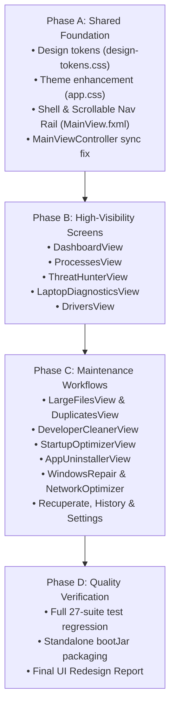

# CleanPilot — Complete UI/UX Redesign Implementation Plan

**Version**: 1.0.0  
**Status**: In Progress  
**Objective**: Modernize, standardize, and responsively engineer CleanPilot desktop application.

---

## 1. Execution Roadmap

---

## 2. Phase A: Shared Foundation & Shell Modernization

### 2.1 Centralized Design Tokens & Stylesheet Refinement
* **File**: `src/main/resources/css/app.css`
* **Changes**:
  1. Define unified CSS custom variables matching `DESIGN_SYSTEM.md` for both light and dark modes.
  2. Normalize card surfaces (`.card`, `.kpi-card`, `.card-hero`), typography scales, and badges.
  3. Ensure visible 2px focus ring (`-color-accent-emphasis`) across all interactive buttons, text fields, and tables.
  4. Implement smooth, minimalist scrollbar styles across all scrollable regions.

### 2.2 Application Shell & Navigation Rail
* **Files**: `src/main/resources/fxml/MainView.fxml`, `src/main/java/com/cleanpilot/controller/MainViewController.java`
* **Changes**:
  1. Wrap sidebar navigation in a `ScrollPane` with `fitToWidth="true"`, transparent background, and hidden horizontal scrollbar, eliminating vertical clipping on displays $<780$px height.
  2. Group navigation into 5 logical categories:
     * **OVERVIEW**: Dashboard
     * **MONITOR**: Processes, Threat Hunter, Laptop Health, Hardware & Drivers
     * **MANAGE**: Large Files, Duplicate Files, Developer Cleanup, Startup Optimizer, App Uninstaller
     * **REPAIR**: System Repair & WinSxS, Network Optimizer, Trash & Recovery
     * **ACTIVITY**: Scan History, Settings
  3. Add `navThreatHunterBtn` into `setActiveNav` array in `MainViewController.java`, fixing the button deselect bug.
  4. Refine title bar header: CleanPilot logo, version pill, zero-telemetry badge, dark/light theme toggle, and window control buttons.

---

## 3. Phase B: High-Visibility Screens

### 3.1 Dashboard Redesign (`DashboardView.fxml`, `DashboardViewController.java`)
* Replace fixed 3-column `HBox` with responsive card layout.
* Restrain hero card gradients to subtle, professional blue-tinted surfaces.
* Wire 1-Click Smart Clean directly to `OperationConfirmationDialog`.
* Organize mounted drives and top resource consumers into clean, scannable lists with progress bars.

### 3.2 Process Monitor (`ProcessesView.fxml`, `ProcessMonitorViewController.java`)
* Real-time rolling 60s CPU and RAM sparklines with accessible labels.
* Responsive toolbar with flexible search, sort combobox, and blockers filter.
* Table column constrained resizing with clear state badges.

### 3.3 Threat Hunter (`ThreatHunterView.fxml`, `ThreatHunterViewController.java`)
* Calibrated objective anomaly labels (`Critical Anomaly`, `High-Confidence Anomaly`, `Investigate`, `Verified / Normal`).
* Responsive master-detail split pane with minimum heights.
* Rich inspector card with `ThreatExplanation` (observed indicators, anomaly rationale, potential benign contexts, recommended investigation steps).
* Safe process freeze and graceful termination with confirmation dialogs.

### 3.4 Hardware Diagnostics & Drivers (`DriversView.fxml`, `LaptopDiagnosticsView.fxml`)
* Refined KPI cards with responsive scaling.
* Laptop Health 2x2 grid adapted for small screens without overlapping.
* Driver compatibility table with clear error and signature badges.

---

## 4. Phase C: Maintenance Workflows

### 4.1 Storage & Duplicates (`LargeFilesView.fxml`, `DuplicatesView.fxml`)
* Flexible search & filter toolbars that do not overflow at 1024px width.
* Interactive treemap tab with clean empty-state placeholder.
* Duplicates auto-select toolbar with clear button groupings.
* Operation preview dialog integration before any deletion.

### 4.2 Developer Cleanup & Startup Optimizer (`DeveloperCleanerView.fxml`, `StartupOptimizerView.fxml`)
* Category toggle buttons with wrapping capability.
* Reversible vs irreversible artifact distinction.
* Startup impact badges (`High`, `Medium`, `Low`, `Disabled`).

### 4.3 App Uninstaller & Windows Repair (`AppUninstallerView.fxml`, `WindowsSystemRepairView.fxml`)
* Segmented tabs for Installed Applications vs Orphaned Residuals.
* Component store and SFC/DISM cards with progress and bounded log viewer.
* UWP debloater table with category filters and safety protections.

### 4.4 Network, Recovery, History & Settings
* Active sockets table with diagnostic leak alerts.
* Recuperate view with two-tier recovery (Quarantine Vault vs Recycle Bin vs Deep Scan).
* Audit timeline and categorized preferences.

---

## 5. Phase D: Quality Verification & Delivery

1. `.\gradlew.bat testClasses`: Compile check.
2. `.\gradlew.bat test`: Full test suite verification across all 27 suites.
3. `.\gradlew.bat bootJar`: Package verified standalone executable.
4. Produce `docs/UI_REDESIGN_REPORT.md` documenting verified results, responsive matrix, and accessibility findings.
