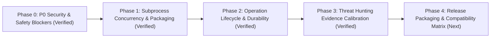

# CleanPilot — Implementation Plan & Phase Milestones

**Version**: 1.0.0-RC1  
**Target Release**: CleanPilot Production Build

---

## 1. Phase Milestones Overview

---

## 2. Phase 0: Verified Critical Safety & Security Blockers (COMPLETED)

* **Objective**: Neutralize all data loss, arbitrary command execution, privilege escalation boundary escapes, and host destabilization risks.
* **Deliverables**:
  1. `RSK-01`: Safe PowerShell UAC elevation via Base64 UTF-16LE encoded commands (`WindowsSecurityUtils.runElevated`).
  2. `RSK-02`: Residual app cleanup safety check (`AppUninstallerService.isSafeResidualPath`) and junction traversal interception.
  3. `RSK-09`: Developer artifact cleanup safety (`DeveloperCleanupService.isSafeArtifactPath`), removing `FOLLOW_LINKS`, and intercepting directory junctions to protect host paths.
  4. `RSK-10`: AppX package debloater command injection prevention (`WindowsAppxDebloaterService.isValidPackageFullName`) and immutable Windows package protection.
  5. `RSK-11`: Critical system path protection in file deletion (`FileDeletionService.isSafeDeletablePath`) protecting Windows, Program Files, user home, and paging/boot files.
  6. `RSK-12`: Path traversal defense in deep recovery extraction (`DeepRecoveryScannerService.recoverToDirectory`).
  7. Fail-safe protection on Rogue Process termination/suspension (`RogueProcessThreatService.isProtectedProcess`) protecting PID $\le 4$, own PID, parent PID, and system binaries under `%SystemRoot%`.
  8. Quarantine vault physical boundary confinement (`QuarantineService.deletePhysicalVaultFile`).

---

## 3. Phase 1: Subprocess Concurrency & Storage Stability (COMPLETED)

* **Objective**: Prevent pipe buffer deadlocks, UI freezing, encoding corruption, and installation crashes.
* **Deliverables**:
  1. `ProcessExecutionUtils`: Non-blocking asynchronous virtual thread stream draining with native console codepage resolution (`getNativeCharset()`).
  2. Subprocess updates: `LaptopDiagnosticsService` (`wevtutil`), `HardwareDriverService` (`pnputil`), `StartupOptimizerService` (`reg`), and `WindowsAppxDebloaterService` (`powershell`).
  3. `RSK-05`: Guarded `submitAsync` across all UI controllers to prevent `RejectedExecutionException`.
  4. `RSK-03`: Relocated SQLite database to user profile (`~/.cleanpilot/cleanpilot.db`) to guarantee write access under `C:\Program Files` MSI installation.
  5. `RSK-06`: Cross-volume file quarantine support (`QuarantineService.moveOrCopyAcrossVolumes`).
  6. `RSK-07`: Dry-run mode for `WindowsComponentStoreService` isolating unit tests from host files.

---

## 4. Phase 2: Shared Operation Lifecycle & Durable Operation Journal (COMPLETED)

* **Objective**: Standardize maintenance tasks under a unified lifecycle:
  `DISCOVER` $\rightarrow$ `VALIDATE` $\rightarrow$ `PREVIEW` $\rightarrow$ `AUTHORIZE` $\rightarrow$ `EXECUTE` $\rightarrow$ `VERIFY` $\rightarrow$ `COMPLETE`.
* **Deliverables**:
  1. `OperationLifecycleManager`: Unified state machine tracking execution state, cancel flags, and exact item metrics.
  2. Durable SQLite operation journal (`OperationJournalEntity`, `OperationJournalRepository`) persisting operation IDs, timestamps, items modified, bytes recovered, and error summaries.
  3. Reusable modal UI confirmation dialog (`OperationConfirmationDialog`) displaying exact target paths, risk badges, irreversible action warnings, and recovery limitations.
  4. UI Controller integration: `DuplicatesViewController`, `LargeFilesViewController`, `DeveloperCleanerViewController`, `AppUninstallerViewController`, and `DashboardViewController` wired to preview dialog.
  5. Automatic interrupted operation reconciliation on application boot (`@PostConstruct reconcileOnStartup`).

---

## 5. Phase 3: Threat Hunter Evidence Calibration & Explainability (COMPLETED)

* **Objective**: Transform heuristic scoring into multi-signal evidence correlation with objective explainability.
* **Deliverables**:
  1. Multi-signal evidence correlation combining executable path, Authenticode signature status, Shannon entropy, active foreign sockets, C2 ports, script engines, and parent process ancestry.
  2. Multi-core normalized CPU delta sampling across consecutive ticks (`getProcessCpuLoadBetweenTicks`) rather than single uncalibrated cumulative spikes.
  3. Developer and build runtime calibration (`node.exe`, `python.exe`, `rustc.exe`, `cargo.exe`, `java.exe`, `cl.exe`, etc.) preventing false-positive crypto-miner classifications in user project directories.
  4. Plain-language explainability model (`ThreatExplanation`): synthesizes observed indicators, anomaly rationale, potential benign contexts, and recommended next investigation steps for every process.
  5. Objective anomaly labeling: replaced unsupported claims of absolute malware with calibrated labels (`Critical Anomaly`, `High-Confidence Anomaly`, `Investigate (Suspicious)`, `Verified / Normal`).
  6. Two-stage graceful process termination: graceful SIGTERM request (`ProcessHandle.destroy()`) with 600ms grace period before escalating to forced termination (`destroyForcibly()`, `taskkill /F`).
  7. Process Freeze and Terminate dialogs integrated with `OperationConfirmationDialog`.

---

## 6. Phase 4: Release Packaging & Verification Gates (COMPLETED)

* **Objective**: Package standalone portable executable bundles and execute end-to-end release verification.
* **Deliverables**:
  1. Multi-platform Gradle distribution tasks (`bootJar`, `packageAppImage`).
  2. Standalone native Windows application bundle created via `jpackage` at `build/dist/CleanPilot/CleanPilot.exe` with bundled Java 21 runtime.
  3. Spring Boot ApplicationContext bootstrap regression test (`ApplicationContextStartupTest`) ensuring zero bean creation or constructor wiring errors.
  4. Live desktop runtime verification: validated clean database initialization, JPA entity manager setup, and system tray registration.
  5. Windows 10 & 11 compatibility verification checklist completed.
