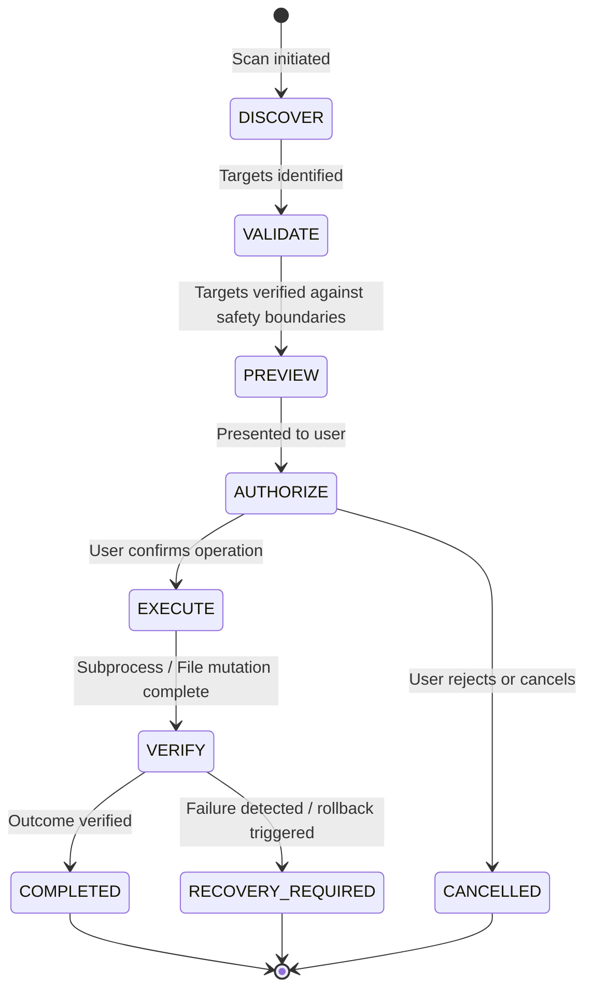

# CleanPilot — Safety Architecture & Execution Boundary Specification

**Version**: 1.0.0-RC1  
**Policy**: Strict Zero-Telemetry & Zero-Destabilization  
**Operating System Target**: Windows 10 & 11 (x64 / ARM64)

---

## 1. Core Safety Principles

1. **Never Destabilize Host Operating System**:
   * No system binary, kernel driver, or critical operating system process may ever be terminated, suspended, or disrupted.
   * Path operations must strictly reject drive roots, `%SystemRoot%`, `%ProgramFiles%`, user profile roots, and system boot/paging files.
2. **Strict Zero-Telemetry**:
   * 100% of operations, threat detection, diagnostics, and repairs execute locally.
   * Zero cloud endpoints, tracking SDKs, or background pings.
3. **Explicit User Consent & Dual-Phase Execution**:
   * All destructive actions require an explicit discovery, validation, and confirmation phase before execution.
   * Previews must show exact target paths, sizes, and risk categories.
4. **Soft-Delete by Default (Quarantine)**:
   * Preference for native Recycle Bin or CleanPilot Quarantine Vault over hard permanent deletion.

---

## 2. Operation Lifecycle Contract

All maintenance operations follow a strict stateful lifecycle:

### Lifecycle States
* **DISCOVER**: Non-invasive directory walk or query without any file/process modification.
* **VALIDATE**: Path boundary enforcement (`isSafeDeletablePath`, `isSafeResidualPath`, `isSafeArtifactPath`).
* **PREVIEW**: Quantified impact display (file count, bytes, warnings).
* **AUTHORIZE**: Modal dialog with explicit confirmation of non-reversible actions.
* **EXECUTE**: Thread-safe background execution with non-blocking virtual thread stream draining.
* **VERIFY**: Check that target was moved or removed as expected without side effects.
* **COMPLETE**: Durable record logged in SQLite audit history.

---

## 3. Privilege Escalation & Subprocess Boundary

### 3.1 Unprivileged Default UI
* The CleanPilot main desktop UI runs unprivileged in standard user context.
* Read-only metrics, hardware sensors, and user-space cache discovery require zero elevation.

### 3.2 Secure Elevation Mechanism
* Subprocesses requiring administrator privileges (e.g., DISM, SFC, Winsock reset, WSL diskpart) are elevated using `WindowsSecurityUtils.runElevated`.
* Elevated commands are encoded in **UTF-16LE Base64 (`powershell.exe -EncodedCommand`)**:
  * Prevents shell quotation escaping flaws.
  * Eliminates command injection vectors (`&`, `;`, `|`, `` ` ``, `$`).
  * Enforces a hard 120-second timeout with asynchronous stream draining to prevent UI freezes.

### 3.3 Safe Subprocess Execution (`ProcessExecutionUtils`)
* Process I/O streams (`stdout` and `stderr`) are consumed asynchronously on virtual threads.
* Output is automatically decoded using Windows native console codepages (`getNativeCharset()`), preventing mojibake on localized Windows editions.
* All child processes enforce hard timeouts and fail-safe process cleanup.

---

## 4. Filesystem Safety & Reparse Point Handling

### 4.1 Reparse Point & Junction Confinement
* CleanPilot file visitors specify `EnumSet.noneOf(FileVisitOption.class)` and explicitly inspect `attrs.isSymbolicLink() || attrs.isOther() || Files.isSymbolicLink(dir)` in `preVisitDirectory`.
* **Never Follow Junctions During Deletion**: Directory junctions (NTFS reparse points) are unlinked directly at the junction node (`Files.delete(dir)` with `FileVisitResult.SKIP_SUBTREE`); their target contents outside the tree are never entered or deleted.

### 4.2 Protected System Boundaries
The following paths are permanently blocked from quarantine, deletion, or modification:
* Drive roots: `C:\`, `D:\`, `\\?\Volume...`
* Windows system roots: `%SystemRoot%`, `%SystemRoot%\System32`, `SysWOW64`, `WinSxS`, `$Recycle.Bin`
* User profile roots: `C:\Users\Username`
* Program Files roots: `C:\Program Files`, `C:\Program Files (x86)`
* Critical boot and paging files: `pagefile.sys`, `swapfile.sys`, `hiberfil.sys`, `bootmgr`, `bootnxt`, `ntldr`, `ntoskrnl.exe`, `hal.dll`

### 4.3 AppX Debloating Boundaries
* Package full names are validated against strict regex syntax: `^[A-Za-z0-9._-]+$`.
* Critical packages are protected: `Microsoft.WindowsStore`, `Microsoft.DesktopAppInstaller`, `Microsoft.MicrosoftEdge`, `Microsoft.Windows.Search`, `Microsoft.Windows.ShellExperienceHost`, `Microsoft.WindowsTerminal`, `Microsoft.WindowsCamera`, `Microsoft.WindowsCalculator`.

### 4.4 Process Protection Boundaries
* PIDs $\le 4$ (System, Idle) are immutable.
* CleanPilot's own PID and parent PID cannot be terminated or suspended.
* Legitimate Windows binaries running from `%SystemRoot%\System32\` (`csrss.exe`, `lsass.exe`, `smss.exe`, `services.exe`, `svchost.exe`, `explorer.exe`) cannot be terminated or suspended.
