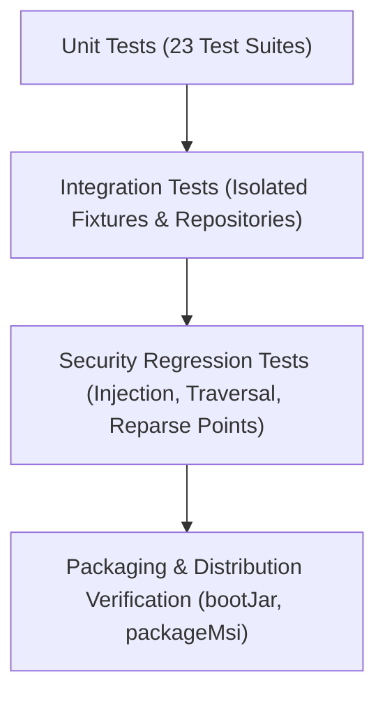

# CleanPilot — Test Strategy & Verification Plan

**Version**: 1.0.0-RC1  
**Target Platform**: Windows 10 & 11

---

## 1. Testing Philosophy & Non-Destructive Invariants

1. **Host Isolation**:
   * Unit and integration tests must **never** execute destructive mutations against the host operating system.
   * Tests targeting filesystem operations use JUnit `@TempDir` isolated temporary directories.
   * Tests targeting Windows Component Store (`WindowsComponentStoreService`) must execute with `dryRun = true`.
2. **Subprocess Isolation**:
   * Commands executed in tests verify argument serialization, stream draining, and timeout handling without triggering system reboots, network resets, or file purges.
3. **No Real Malware in Test Environments**:
   * Threat detection tests use harmless synthetic fixtures: high-entropy mock byte arrays, unsigned test scripts, and benign test processes.

---

## 2. Test Pyramid & Coverage Scope



### 2.1 Security & Safety Regression Test Suites

| Test Suite | File Path | Focus Areas |
| :--- | :--- | :--- |
| **`FileDeletionServiceTest`** | `src/test/java/com/cleanpilot/service/FileDeletionServiceTest.java` | Path boundary enforcement (`isSafeDeletablePath`), refusal of drive roots, Windows, Program Files, user home root, boot/paging files. |
| **`DeveloperCleanupServiceTest`** | `src/test/java/com/cleanpilot/service/DeveloperCleanupServiceTest.java` | Developer artifact discovery, `isSafeArtifactPath` validation, junction interception without target modification. |
| **`WindowsAppxDebloaterServiceTest`** | `src/test/java/com/cleanpilot/service/WindowsAppxDebloaterServiceTest.java` | Package full name regex validation (`^[A-Za-z0-9._-]+$`), command injection payload rejection, immutable package protection. |
| **`DeepRecoveryScannerServiceTest`** | `src/test/java/com/cleanpilot/service/DeepRecoveryScannerServiceTest.java` | Path traversal defense in `recoverToDirectory`, collision renaming, missing source exception handling. |
| **`QuarantineServiceTest`** | `src/test/java/com/cleanpilot/service/QuarantineServiceTest.java` | Cross-volume copy fallback, soft-delete move, physical deletion confinement strictly inside vault directory. |
| **`ProcessExecutionUtilsTest`** | `src/test/java/com/cleanpilot/util/ProcessExecutionUtilsTest.java` | Asynchronous virtual thread stream draining, timeout enforcement, native codepage decoding. |
| **`WindowsSecurityUtilsTest`** | `src/test/java/com/cleanpilot/util/WindowsSecurityUtilsTest.java` | Safe elevated PowerShell execution, Base64 UTF-16LE encoding, administrator status query without hangs. |
| **`AppUninstallerServiceTest`** | `src/test/java/com/cleanpilot/service/AppUninstallerServiceTest.java` | Safe residual path check (`isSafeResidualPath`), depth $\ge 3$, junction safety in residual deletions. |
| **`RogueProcessThreatServiceTest`** | `src/test/java/com/cleanpilot/service/RogueProcessThreatServiceTest.java` | Protected process identification (PID $\le 4$, own PID, parent PID, System32 binaries under `%SystemRoot%`), entropy calculation. |

---

## 3. Test Execution Commands

```powershell
# Run the complete test suite
.\gradlew.bat test

# Run targeted security regression tests
.\gradlew.bat test --tests "com.cleanpilot.service.FileDeletionServiceTest"
.\gradlew.bat test --tests "com.cleanpilot.service.WindowsAppxDebloaterServiceTest"
.\gradlew.bat test --tests "com.cleanpilot.service.DeveloperCleanupServiceTest"
.\gradlew.bat test --tests "com.cleanpilot.service.DeepRecoveryScannerServiceTest"
.\gradlew.bat test --tests "com.cleanpilot.service.QuarantineServiceTest"

# Verify standalone distribution packaging
.\gradlew.bat bootJar
```
